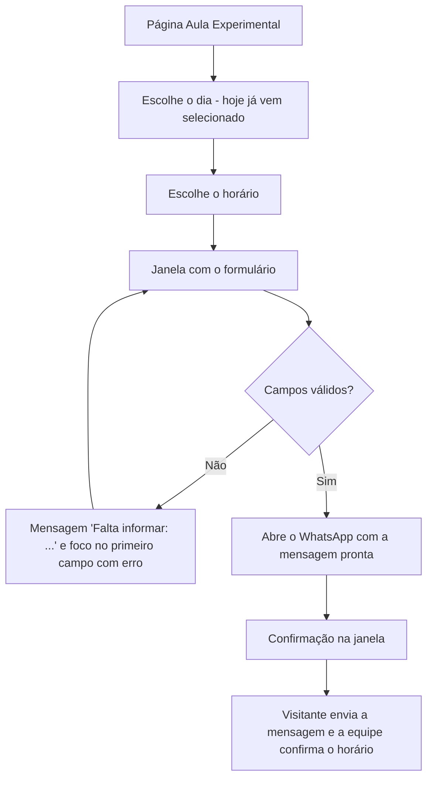

# Documentação do sistema de agendamento

Este documento descreve como o sistema de **agendamento de aula experimental** foi integrado ao site da PKZ Lab & One to One: onde ele aparece, como funciona para o visitante, como funciona por dentro, o que foi testado e quais são as limitações conhecidas.

## 1. Visão geral

O agendamento permite que o visitante **escolha um dia e um horário**, **preencha um formulário** (modalidade, nome, telefone, CPF e observação) e **envie o pedido pelo WhatsApp** da marca. Não há servidor nem banco de dados: o site monta uma mensagem pronta e abre o WhatsApp (`wa.me`) para a pessoa enviar. A equipe da marca confirma o horário pelo próprio WhatsApp.

O sistema é feito só com **HTML, CSS e JavaScript puro**, e **um único script (`agendamento.js`) atende as duas marcas**. O que muda entre PKZ Lab e One To One (nome, número, modalidades) vem do arquivo `data.js`.

---

## 2. Onde ele aparece

Cada marca tem a sua página de agendamento:

| Marca | Página | Como chegar |
|---|---|---|
| PKZ Lab | `pages/pkz-aula-experimental.html` | Botão **Aula Experimental** no topo da página da PKZ, item **Aula Experimental** no menu, botões **Agendar aula** (faixa de conversão e barra fixa no celular) e link no texto da seção de aula experimental |
| One To One | `pages/one-to-one-aula-experimental.html` | Os mesmos pontos de entrada, na página `pages/one-to-one.html` |

As páginas de agendamento têm o mesmo menu, rodapé, janela de contato e botão de voltar ao topo das outras páginas da marca, e um link para a outra marca (**Studio One To One →** / **PKZ Lab →**).

---

## 3. Como funciona para o visitante

1. O visitante entra na página de **Aula Experimental** da marca.
2. Vê uma fileira de **dias da semana** (Seg a Dom). O dia de **hoje** já vem selecionado.
3. Abaixo, aparece a lista de **horários** do dia selecionado (07:00 às 22:00, de hora em hora). Para mudar de dia, basta tocar em outro botão de dia.
4. Ao tocar em um horário, abre uma **janela** (`<dialog>`) "Confirme sua Aula Experimental", com o dia e o horário escolhidos no topo.
5. O visitante preenche **modalidade, nome completo, telefone/WhatsApp, CPF**, uma **observação opcional** e marca a **autorização de uso dos dados** (com link para a Política de Privacidade).
6. Ao tocar em **Enviar pelo WhatsApp →**, o site valida os campos:
   - se algo estiver errado, mostra uma mensagem **"Falta informar: …"**, destaca os campos com problema e leva o foco para o primeiro deles;
   - se estiver tudo certo, **abre o WhatsApp** da marca com a mensagem pronta (em outra aba).
7. A janela passa a mostrar a confirmação: *"Abrimos o WhatsApp com o seu pedido para [dia] às [horário]. Envie a mensagem para a equipe confirmar o horário."* e o botão **Fechar**.
8. O visitante **envia a mensagem no WhatsApp**. O horário só é considerado agendado quando a equipe confirma.



---

## 4. Arquivos envolvidos

| Arquivo | Papel no agendamento |
|---|---|
| `pages/pkz-aula-experimental.html` | Página da PKZ: estrutura da agenda (`#day-chips`, `#time-heading`, `#time-list`) e a janela do formulário (`#booking-modal`). Define `data-brand="pkz"` no `<html>`. |
| `pages/one-to-one-aula-experimental.html` | Idem para a One To One, com `data-brand="oto"`. A estrutura é a mesma; só mudam textos, fontes e o CSS da marca. |
| `js/data.js` | **Fonte única de dados** das duas marcas: nome, WhatsApp, modalidades, dias e horários, endereço e Instagram. Cria o objeto `BRAND` com os dados da marca da página atual. |
| `js/agendamento.js` | **Lógica do agendamento**: gera os dias e horários, abre a janela, aplica máscaras, valida o formulário, monta a mensagem e abre o WhatsApp. |
| `js/main.js` | Comportamentos comuns da página (menu hambúrguer, janela de contato, links de WhatsApp, voltar ao topo). É carregado **antes** do `agendamento.js`. |
| `css/base.css` | Estilos da agenda (`.day-chips`, `.day-chip`, `.time-list`, `.time-slot`), da janela e do formulário (`.modal-*`, `.booking-*`). |
| `css/pkz.css` e `css/one-to-one.css` | Cores e identidade de cada marca, aplicadas por cima do `base.css`. |

Ordem de carregamento dos scripts nas duas páginas (todos com `defer`): `data.js` → `main.js` → `agendamento.js`.

---

## 5. Como funciona por dentro

### 5.1 Dados por marca (`data.js`)

O `<html>` de cada página declara a marca (`data-brand="pkz"` ou `data-brand="oto"`). O `data.js` lê esse atributo e cria `window.BRAND` com os dados daquela marca. O `agendamento.js` usa só o `BRAND`, sem saber qual é a marca.

| Dado | PKZ Lab | One To One |
|---|---|---|
| Nome (usado na mensagem) | `PKZ Lab` | `One To One` |
| Modalidades do formulário | Karatê, Jiu-Jitsu, Vôlei, Futebol, Natação, Atletismo, Outro esporte | Personal Training, Fisioterapia, Nutrição |
| Dias | Segunda a Domingo | Segunda a Domingo |
| Horários | 07:00 às 22:00, de hora em hora (16 por dia) | 07:00 às 22:00, de hora em hora (16 por dia) |
| WhatsApp | `5521000000000` (**valor de exemplo**) | `5521000000000` (**valor de exemplo**) |

Os dias e horários são gerados pela mesma função nas duas marcas, então hoje são idênticos.

### 5.2 Lógica (`agendamento.js`)

| Parte | O que faz |
|---|---|
| Modalidades | Preenche o campo "Modalidade" com `BRAND.modalities`. |
| Botões de dia | Criados a partir de `SCHEDULE.days`. O selecionado recebe `aria-pressed="true"`. No celular, o botão do dia escolhido é centralizado na faixa que rola, sem rolar a página. |
| Lista de horários | `selectDay()` troca o título ("Horários de Quarta-feira") e recria os botões de horário. |
| Dia inicial | Usa `new Date().getDay()` para selecionar **o dia de hoje**. Se hoje não estiver na lista, seleciona a segunda-feira. |
| Janela do formulário | `openBookingModal()` guarda o dia/horário escolhidos, mostra o formulário limpo e abre o `<dialog>` com `showModal()`. Fecha pelo botão ×, pelo botão **Fechar**, clicando no fundo escuro ou com **Esc**. |
| Máscara do CPF | Formata como `000.000.000-00` enquanto a pessoa digita (aceita só números, até 11). |
| Máscara do telefone | Formata como `(21) 3333-4444` (fixo, 10 dígitos) ou `(21) 99999-8888` (celular, 11 dígitos). |
| Validação do CPF | `isValidCpf()` confere os **dígitos verificadores** e rejeita sequências repetidas como `111.111.111-11`. |
| Validação do formulário | Ao enviar, junta os campos com problema, marca `aria-invalid="true"`, mostra o erro e foca o primeiro. |
| Mensagem e envio | Monta o texto, codifica com `encodeURIComponent` e abre `https://wa.me/<número>?text=<mensagem>` em outra aba (`noopener,noreferrer`). |
| Confirmação | Esconde o formulário, mostra a confirmação, foca o botão **Fechar** e limpa o formulário (`reset()`). |

### 5.3 Regras de validação

| Campo | Regra | Mensagem de erro (trecho) |
|---|---|---|
| Modalidade | Obrigatória (uma opção selecionada) | "a modalidade" |
| Nome completo | Obrigatório (espaços nas pontas são ignorados) | "seu nome" |
| Telefone / WhatsApp | Mínimo de **10 dígitos** (DDD + número) | "um telefone com DDD" |
| CPF | **11 dígitos válidos** (dígitos verificadores corretos) | "um CPF válido" |
| Autorização | Caixa marcada | "a autorização de uso dos dados" |
| Observação | Opcional | (sem erro) |

Quando há mais de um problema, a mensagem lista todos. Exemplo com tudo vazio:

> Falta informar: a modalidade, seu nome, um telefone com DDD, um CPF válido, a autorização de uso dos dados.

### 5.4 Mensagem enviada ao WhatsApp

Exemplo real gerado pelo site (PKZ Lab, quarta-feira às 18:00):

```
Olá, equipe PKZ Lab! Quero agendar uma aula experimental pelo site.
Horário: Quarta-feira às 18:00
Modalidade: Karatê
Nome: Maria Teste
Telefone: (21) 99999-8888
CPF: 529.982.247-25
Observação: Primeira vez
```

A linha **Observação** só aparece se o campo tiver sido preenchido. Na One To One, a primeira linha começa com "Olá, equipe One To One!".

---

## 6. Layout, responsividade e acessibilidade

**Mobile first.** O CSS da agenda segue a mesma regra do resto do site: o que está fora de `@media` é o layout do celular.

| Tela | Dias | Horários |
|---|---|---|
| Celular (até 640 px) | Uma única faixa que **rola para o lado** (sem barra de rolagem visível) | Grade que preenche a largura, com botões de no mínimo 6 rem (3 colunas em 390 px) |
| A partir de 641 px | Botões **quebram linha** e ficam centralizados | Grade |
| A partir de 1101 px | Idem | Botões de no mínimo 8 rem em grade larga (7 colunas em 1280 px) |

Todos os botões de dia e de horário têm **altura mínima de 2,75 rem** (área de toque confortável).

**Acessibilidade:**
- Botões de dia com `aria-pressed` e `aria-label`; botões de horário com `aria-label` ("Quarta-feira às 18:00").
- Título dos horários com `aria-live="polite"`: leitores de tela avisam quando o dia muda.
- Janela feita com `<dialog>` nativo (foco preso dentro, fecha com **Esc**), com `aria-labelledby`.
- Erros em um elemento com `role="alert"`, campos inválidos com `aria-invalid` e campos ligados à mensagem por `aria-describedby`.
- Confirmação com `role="status"`.
- Link "Pular para o conteúdo" no topo da página.
- Sem JavaScript, a página mostra um aviso (`<noscript>`) com um link direto para o WhatsApp.
- Respeita `prefers-reduced-motion`.

---

## 7. Alterações em relação à lógica fornecida pelo professor

O professor disponibilizou a lógica em JavaScript do agendamento. A equipe a **integrou ao site** e a adaptou para atender as **duas marcas com um único script**.

**O que se observa no código atual:**

| Alteração | Detalhe |
|---|---|
| Dados separados da lógica | Marca, número de WhatsApp, modalidades, dias, horários e endereço ficam em `data.js`. O `agendamento.js` lê tudo do objeto `BRAND`. Para mudar um horário ou um número não é preciso mexer na lógica nem no HTML. |
| Um script para as duas marcas | A marca vem do atributo `data-brand` do `<html>`. O mesmo `agendamento.js` é usado em `pkz-aula-experimental.html` e `one-to-one-aula-experimental.html`. |
| Envio pelo WhatsApp | O pedido é enviado por mensagem pronta no WhatsApp da marca, em vez de ficar só na tela. |
| Validação | CPF validado pelos dígitos verificadores, máscaras de CPF e telefone, mensagem única listando todos os campos com problema e foco no primeiro erro. |
| Visual | O CSS da agenda, da janela e do formulário foi escrito pela equipe (`base.css`) e ganhou a identidade de cada marca (`pkz.css` e `one-to-one.css`). O professor liberou o CSS para edição livre. |

> **Confirmar com o grupo antes de entregar:** no histórico do Git, `agendamento.js` e `data.js` entraram juntos em um único commit ("Adicionando js base", 25/10) e **não foram alterados depois**, e o repositório não guarda a versão original do professor para comparação. Por isso, a tabela acima descreve o que existe hoje no código. Se o grupo lembrar de outras mudanças feitas sobre o arquivo original (ou de trechos que foram mantidos sem alteração), acrescente aqui.

---

## 8. Testes realizados

Depois da integração, o fluxo completo foi testado em **25/10/2026** abrindo as duas páginas em um navegador automatizado (Chromium), em **celular (390 px de largura)** na PKZ Lab e em **desktop (1280 px)** na One To One. Resultado:

| # | O que foi testado | Resultado |
|---|---|---|
| 1 | Os 7 botões de dia (Seg a Dom) são criados e o dia de hoje vem selecionado | Passou |
| 2 | Cada dia mostra os 16 horários (07:00 a 22:00) | Passou |
| 3 | Trocar de dia atualiza o título e a lista ("Horários de Quarta-feira") | Passou |
| 4 | Tocar em um horário abre a janela com o dia e o horário no topo (ex.: "Quarta-feira · 18:00") | Passou |
| 5 | O campo Modalidade traz as opções certas de cada marca | Passou |
| 6 | Enviar o formulário vazio mostra o erro com os 5 campos e marca os 5 como inválidos | Passou |
| 7 | Máscara de telefone: celular `(21) 99999-8888` e fixo `(21) 3333-4444` | Passou |
| 8 | Máscara de CPF: `111.111.111-11` | Passou |
| 9 | CPF com dígitos inválidos (`111.111.111-11`) é recusado ("um CPF válido") | Passou |
| 10 | Sem a autorização de dados, o envio é recusado | Passou |
| 11 | Com tudo correto, abre o link `wa.me` com a mensagem esperada (nome da marca, horário, modalidade, nome, telefone, CPF e observação) | Passou |
| 12 | Após o envio, a janela mostra a confirmação e esconde o formulário | Passou |
| 13 | O botão **Fechar** fecha a janela; ao escolher outro horário o formulário reabre limpo | Passou |
| 14 | **Esc** fecha a janela | Passou |
| 15 | Faixa de dias rola para o lado no celular e quebra linha no desktop | Passou |
| 16 | Sem rolagem horizontal na página (390 px e 1280 px) | Passou |
| 17 | Nenhum erro de JavaScript no console nas duas páginas | Passou |

**Conclusão:** o fluxo funciona nas duas marcas, no celular e no desktop.

---

## 9. Limitações e pontos de atenção

- **Número de WhatsApp de exemplo.** `5521000000000` em `data.js` (uma vez por marca) e no `<noscript>` de cada página de aula experimental. Troque pelos números reais antes de publicar.
- **Sem controle de vagas.** Todos os horários de todos os dias aparecem sempre disponíveis, e os mesmos nas duas marcas. A disponibilidade real é combinada pela equipe no WhatsApp. Os horários em `data.js` devem ser ajustados aos horários reais das marcas.
- **Sem servidor.** O pedido não fica registrado no site; ele só existe na mensagem do WhatsApp. O visitante precisa **enviar** a mensagem para o pedido chegar à equipe.
- **Dado pessoal na mensagem.** O CPF vai escrito na mensagem do WhatsApp. Por isso o formulário exige a autorização e aponta para a Política de Privacidade (`pages/privacidade.html`, que é um modelo e precisa ser revisado pelo responsável legal).
- **Dia inicial depende do aparelho.** O dia pré-selecionado usa a data do dispositivo do visitante.
- **Mudanças em arquivos compartilhados** (`base.css`, `cta.css`, `extras.css` e os scripts em `js/`) afetam as duas marcas: combinar antes e testar a PKZ e a One To One.

---

## 10. Como alterar

| Quero… | Onde mexer |
|---|---|
| Trocar o número de WhatsApp | `js/data.js` (`whatsapp`, em cada marca) **e** o `<noscript>` das duas páginas `*-aula-experimental.html` |
| Mudar os horários ou os dias | `js/data.js`, na função `schedule()` (`days` e `times`). Para ter horários diferentes por marca, criar um `schedule` próprio para cada uma |
| Mudar as modalidades do formulário | `js/data.js` (`modalities`) |
| Mudar o texto da mensagem enviada | `js/agendamento.js`, no evento `submit` do formulário |
| Mudar o visual da agenda ou do formulário | `css/base.css` (seções "Aula Experimental: agenda" e `.modal-*`/`.booking-*`) e `css/pkz.css` / `css/one-to-one.css` |

Depois de qualquer alteração em `agendamento.js` ou `data.js`, **refaça o teste completo** da seção 8 nas duas marcas. Se a funcionalidade quebrar, volte para a versão anterior do arquivo.
